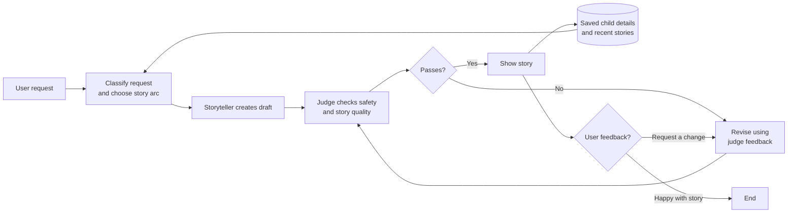

# Hippocratic AI Coding Assignment
Welcome to the [Hippocratic AI](https://www.hippocraticai.com) coding assignment

## Instructions
The attached code is a simple python script skeleton. Your goal is to take any simple bedtime story request and use prompting to tell a story appropriate for ages 5 to 10.
- Incorporate a LLM judge to improve the quality of the story
- Provide a block diagram of the system you create that illustrates the flow of the prompts and the interaction between judge, storyteller, user, and any other components you add
- Do not change the openAI model that is being used.
- Please use your own openAI key, but do not include it in your final submission.
- Otherwise, you may change any code you like or add any files

---

## Rules
- This assignment is open-ended
- You may use any resources you like with the following restrictions
   - They must be resources that would be available to you if you worked here (so no other humans, no closed AIs, no unlicensed code, etc.)
   - Allowed resources include but not limited to Stack overflow, random blogs, chatGPT et al
   - You have to be able to explain how the code works, even if chatGPT wrote it
- DO NOT PUSH THE API KEY TO GITHUB. OpenAI will automatically delete it

---

## What does "tell a story" mean?
It should be appropriate for ages 5-10. Other than that it's up to you. Here are some ideas to help get the brain-juices flowing!
- Use story arcs to tell better stories
- Allow the user to provide feedback or request changes
- Categorize the request and use a tailored generation strategy for each category

---

## How will I be evaluated
Good question. We want to know the following:
- The efficacy of the system you design to create a good story
- Are you comfortable using and writing a python script
- What kinds of prompting strategies and agent design strategies do you use
- Are the stories your tool creates good?
- Can you understand and deconstruct a problem
- Can you operate in an open-ended environment
- Can you surprise us

---

## Other FAQs
- How long should I spend on this?
No more than 2-3 hours
- Can I change what the input is?
Sure
- How long should the story be?
You decide

---

## Solution overview

This implementation treats bedtime storytelling as a controlled generation
process rather than a single prompt. The required `gpt-3.5-turbo` model performs
four roles with separate instructions:

1. A **classifier** turns a loose parent request into a category and a few
   storytelling dimensions. The category remains internal; the same call also
   creates a natural acknowledgement grounded in the parent's actual details.
2. A **conversation agent** understands feedback in the context of the current
   story, replies naturally, and routes a revision, question, clarification, or
   acceptance. When a parent supplies a creative influence, it derives a runtime
   adaptation brief rather than looking up a hardcoded theme.
3. A **storyteller** applies a category-specific arc and bedtime-writing rules.
4. A **judge** scores the draft and requests concrete changes before a story is
   shown.

The parent can request further changes. Every request, draft, judge review, and
revision is appended to a local SQLite history. A returning user's recent stories
are provided to the storyteller and judge in shortened form so they can avoid
repeating the same plot mechanism, special object, resolution, or repeated
phrase.

The web experience adds a calm, responsive day/night storybook interface,
story-related motion, optional expressive narration, and an expandable list of
the returning user's three most recent stories. Past stories are loaded only
after the user identifies themselves and remain local to the SQLite database.

## What I would build with two more hours

I would add a small, versioned evaluation set covering ages 5-7 and 8-10,
ambiguous requests, emotionally sensitive themes, unsafe requests, follow-up
clarifications, and returning-user memory. I would run it against both the
first draft and judged draft to measure whether the review loop consistently
improves rubric scores without flattening originality. I would also add profile
management controls so a parent can inspect, correct, or delete remembered
child details and story history from the interface.

## Run the CLI

Python 3.9 or newer is recommended.

```bash
python3 -m venv .venv
source .venv/bin/activate
pip install -r requirements.txt
cp .env.example .env
# Open .env and replace the placeholder with your own API key.
python main.py
```

The API key is read from the environment and must never be committed. The local
`stories.db` file is also ignored because it contains user-generated history.
At the story prompt, an empty submission activates surprise mode: the model
chooses the protagonist, world, emotional theme, and gentle conflict while using
recent history to avoid repeating earlier stories.
The story arc determines the finished length. There is no minimum word count or
read-aloud duration, so the storyteller can end once the central choice is
resolved and the bedtime decrescendo is complete. Python records the resulting
word count and estimated duration for transparency, but neither affects whether
the story passes review.

## Run the web interface

The optional UI is a mobile-first React/Vite application connected to the same
Python pipeline through a FastAPI WebSocket. Node.js 20 or newer is recommended.
The API key remains in the Python process and is never sent to browser code.

For development, use two terminals:

```bash
# Terminal 1: Python API
source .venv/bin/activate
python -m uvicorn api:app --reload --port 8000
```

```bash
# Terminal 2: React development server
cd frontend
npm install
npm run dev
```

Open `http://127.0.0.1:5173`. Vite proxies the API and WebSocket to port 8000.

For a single production-style server:

```bash
cd frontend
npm install
npm run build
cd ..
source .venv/bin/activate
python -m uvicorn api:app --port 8000
```

Open `http://127.0.0.1:8000`. FastAPI serves the built frontend alongside the
health endpoint and WebSocket.

The UI includes sky-and-earth day and night themes, phone layout, focus mode,
conversational revisions, a collapsible judge panel, and model-selected glyph
animations. The classifier returns a constrained visual motif—glyphs, mood, and
one supported motion—so interests influence the waiting scene without allowing
the model to send executable animation code. Once a returning user is
recognized, the conversation rail also shows up to three recent stories below
the feedback form; each title expands to reveal the saved story without
replacing the current draft.

### Optional expressive narration

The story player uses local **Chatterbox Nano** narration when its isolated
environment is installed. Nano runs on CPU and remains separate from the
Python 3.9 story environment:

```bash
python3.11 -m venv .venv-tts
.venv-tts/bin/python -m pip install -r requirements-tts.txt
```

No second server command is required. On the first narration request, `api.py`
starts the local-only narrator service and waits for it to become ready. The
first use also downloads Chatterbox's roughly 3 GB model bundle into the ignored
`.tts-cache/` directory; later requests reuse the loaded model and cache each
finished WAV by story text.

If Python 3.11, Chatterbox, or the local service is unavailable, the same player
automatically falls back to the browser's `speechSynthesis` voice. Its status
text always says either `Chatterbox Nano` or `Browser voice fallback`, so the
active path is visible rather than inferred from the sound. Read, pause, resume,
stop, and Calm/Normal speed controls work with both paths.

## System diagram

The classifier, storyteller, conversation agent, and judge are separate prompt
roles executed by the assignment's required `gpt-3.5-turbo` model. Python owns
the workflow, score calculation, retry limits, persistence, and final safety
decision; the model does not decide whether its own output is accepted.



## Tailored generation strategies

The classifier chooses one primary story category. Animals, fairies, and people
are treated as a separate `world` dimension because they can appear in any plot
type.

| Category | Tailored arc |
|---|---|
| `gentle_adventure` | Safe invitation, manageable obstacles, personal strength, cozy return |
| `cozy_mystery` | Harmless question, understandable clues, warm discovery, full resolution |
| `emotional_growth` | Small trigger, emotion shown through behavior, support, constructive choice |
| `friendship_and_helping` | Notice a need, hesitate, help, work together, quiet connection |
| `comfort_and_routine` | Familiar routine, small disruption, repeated comfort, calm restored |
| `imaginative_play` | Playful idea, connected discoveries, gentle return to bedtime |

The shared storyteller prompt is a story-craft specification rather than a list
of prohibited content. Before writing, the model silently chooses the child's
goal, a low-stakes obstacle, two connected choices, one useful everyday action,
a three-beat repeated image, and the final resting image. The finished story
must let the child's action earn the resolution; magic can reveal possibilities
but cannot solve the problem for them.

The prompt also defines four testable bedtime-writing hypotheses:

- **Calm without boredom:** create interest through curiosity, relationships,
  sensory detail, and choice rather than danger or continuous novelty.
- **Age-calibrated dialogue:** ages 5-7 receive fewer speakers, concrete language,
  and one short idea per spoken line; ages 8-10 receive modestly richer inference.
- **Purposeful repetition:** one phrase, sound, action, or image appears about
  three times—first for familiarity, then during the central choice, and finally
  in a softer variation.
- **Bedtime decrescendo:** after resolution, introduce nothing new and gradually
  reduce dialogue, action, light, and sound toward a complete resting image.

Emotional learning is shown through physical behavior, concise dialogue, and a
portable action such as noticing someone who needs help, waiting, asking before
touching an animal, making space, apologizing, or trying a kinder approach.
Feelings themselves are not treated as bad, and the story never states a moral.

## Judge and revision policy

The judge returns JSON containing a safety decision, six 1-5 scores, successful
details to preserve, and specific requested changes. Python then calculates the
weighted overall score out of 10. It evaluates:

- age fit;
- personalization;
- learning through action;
- story arc;
- bedtime pacing; and
- originality relative to recent stories.

A draft passes only when it is safe, its weighted score is at least 8/10, the
critical age-fit, story-arc, and bedtime-pacing dimensions are at least 4/5, and
no dimension is below 3/5. The weights are 20% each for age fit, story arc, and
bedtime pacing; 15% each for personalization and learning through action; and
10% for originality. A score near 5/10 represents a draft that still needs
revision, so it is not an appropriate acceptance threshold.

Python, rather than the model, makes the acceptance decision and enforces the
two-revision limit. If the judge emits malformed JSON, one model call reformats
the same assessment. An unsafe story that still fails after the revision budget
is not displayed.

The judge is another call to the required model, not an independent source of
truth. The bounded loop improves consistency, but actual story quality should be
validated by reading representative outputs.

## Database design

The application intentionally uses only two tables:

- `users` contains `user_id` and unique `user_name`.
- `messages` contains the `user_id`, `story_id`, role, content, category, and
  timestamp.

Prompts and responses are separate rows. The role is `user`, `assistant`, or
`judge`. Messages are never overwritten, so one `story_id` provides an ordered
audit trail from the first request through judge-directed and parent-directed
revisions.

The latest normalized child profile is also appended to `messages` as a `user`
row with category `child_profile`. This keeps the two-table design while letting
a returning account remember the child's name, age, interests, and emotional
context. New facts replace or extend that profile; they are never inferred from
the account holder's name. Existing histories without a profile row are
backfilled once from their most recent opening request.

SQLite history does not automatically give the model memory. The application
explicitly retrieves the latest version of up to three earlier stories and
places shortened excerpts into the storyteller and judge prompts. This keeps the
context bounded while providing a practical originality signal.

## Files

- `main.py`: model calls, scoring, classification, judging, and conversation flow.
- `api.py`: FastAPI health route, WebSocket stages, and UI story sessions.
- `tts_service.py`: optional local Chatterbox Nano synthesis and WAV caching.
- `database.py`: the two-table SQLite persistence layer.
- `frontend/`: React, Vite, TypeScript, Motion animations, and responsive styles.
- `prompts/classifier.txt`: request-classification instructions and schema.
- `prompts/conversation.txt`: contextual dialogue, intent, and revision routing.
- `prompts/storyteller.txt`: shared age, safety, tone, and pacing instructions.
- `prompts/judge.txt`: scoring rubric and review-output schema.
- `prompts/arcs.json`: category-specific story strategies.
- `requirements.txt`: Python dependency.
- `requirements-tts.txt`: isolated Python 3.11 narration dependencies.
- `.env.example`: safe API-key template.
- `.gitignore`: excludes credentials, local environments, and story history.

## Privacy and repository hygiene

This is a local demonstration, not a production child-data system. Names,
prompts, profiles, reviews, and stories are stored unencrypted in `stories.db`.
That database, `.env`, model caches, virtual environments, generated audio, and
frontend build artifacts are excluded from Git. `.env.example` documents the
only required secret without containing a real credential.

Before sharing the project, verify the ignore rules with:

```bash
git check-ignore -v .env stories.db .venv .venv-tts .tts-cache frontend/node_modules frontend/dist
git grep -nE 'sk-[A-Za-z0-9_-]{20,}' -- . ':!*.lock'
```

The second command should produce no output.
